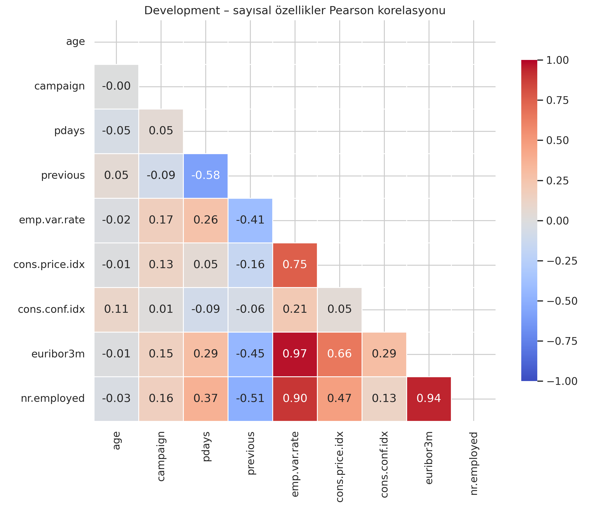
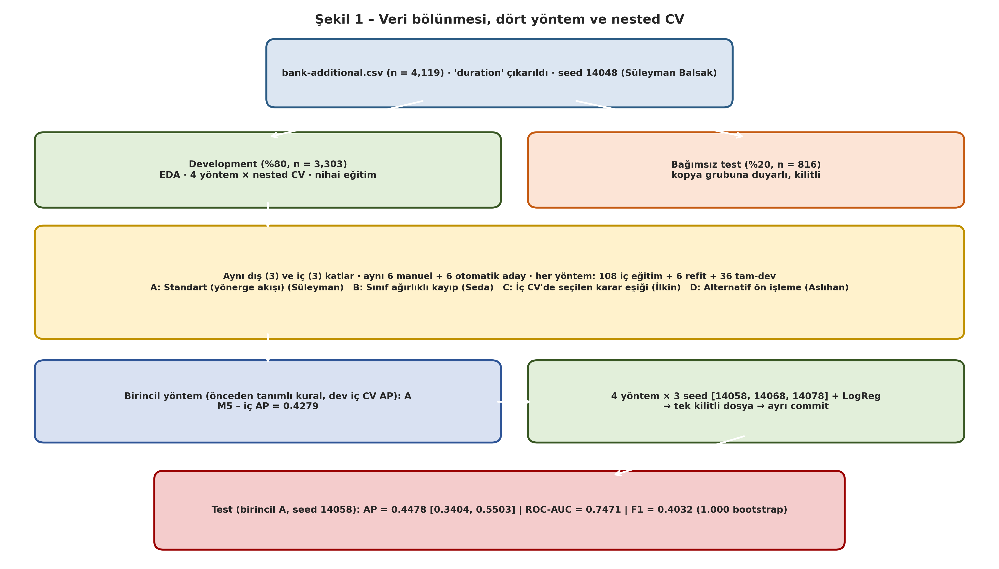
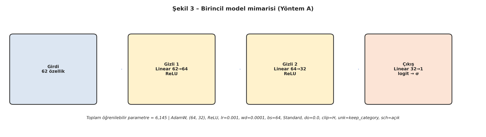
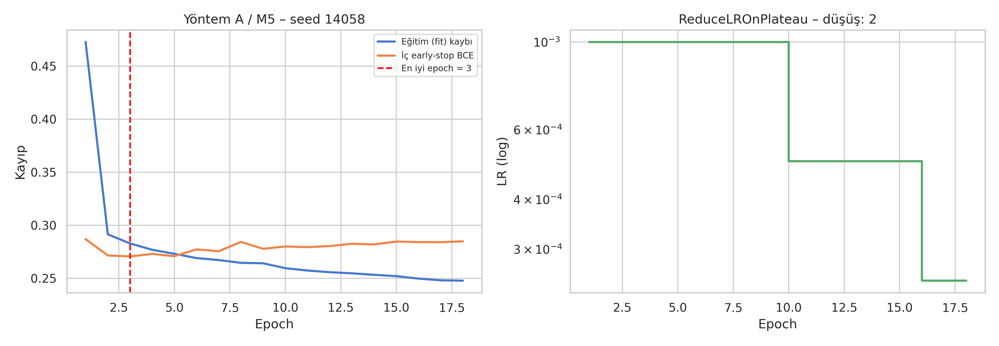
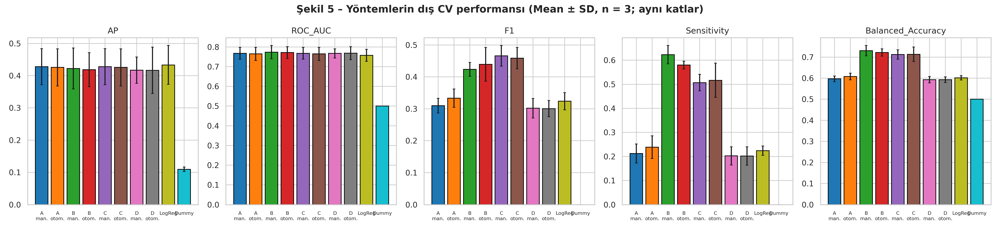
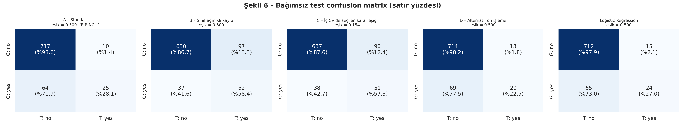
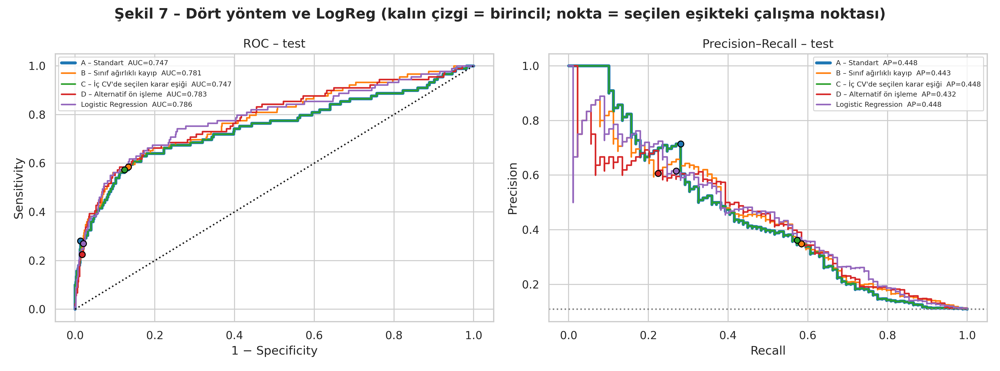

# Özet ve araştırma sorusu

Bu çalışmada UCI Bank Marketing veri setinin `bank-additional.csv` sürümü (4.119 gözlem) üzerinde, müşterinin vadeli mevduat kampanyasına abone olup olmayacağı PyTorch tabanlı çok katmanlı algılayıcılarla (MLP) tahmin edilmiştir. Pozitif sınıf oranı %10,95'tir. Görüşme süresi (`duration`) görüşme öncesinde bilinmediği için tüm modellerden çıkarılmıştır. Model seçimi kopya kayıtlara duyarlı 3×3 nested cross-validation ile yapılmış, her arama yönteminde 6 manuel ve 6 otomatik aday karşılaştırılmıştır. Grubun dört üyesi aynı veri, seed ve katlar üzerinde dört farklı yöntem ailesini uygulamıştır: (A) yönergenin standart akışı, (B) sınıf ağırlıklı kayıp, (C) iç CV'de seçilen karar eşiği ve (D) alternatif ön işleme. Önceden tanımlı kuralla seçilen birincil model (Yöntem A, aday M5) bağımsız testte AP = 0,448 [%95 GA 0,340–0,550] ve ROC-AUC = 0,747 elde etmiştir. Bu değer, sabit ön işlemeli Logistic Regression'ın (AP = 0,448) düzeyindedir. Dört yöntem sıralama başarısında (AP, ROC-AUC) birbirinden ayırt edilemezken, sınıf ağırlığı (B) ve iç CV ile seçilen eşik (C) azınlık sınıfı yakalama oranını 0,28'den 0,57–0,58'e çıkarmıştır.

**Araştırma sorusu:** Dengesiz bir ikili sınıflandırma probleminde MLP'nin performansı ön işleme, optimizer, eğitim kaybı ve karar kuralı tercihlerine ne kadar duyarlıdır ve bu tercihler doğrusal bir referans modele göre fark yaratır mı?

# 1. Giriş

Çok katmanlı algılayıcılar doğrusal olmayan karar sınırlarını öğrenebilir. Ancak tablosal ve küçük veri setlerinde başarıları mimari, optimizer, öğrenme oranı, düzenlileştirme ve ön işleme gibi çok sayıda tercihe bağlıdır. Bu tercihler aynı veri üzerinde hem seçilip hem de değerlendirildiğinde performans iyimser biçimde yanlı tahmin edilir. Nested cross-validation bu sorunu iki döngüyü ayırarak çözer: iç döngü konfigürasyon seçer, dış döngü ise seçim *prosedürünün* genelleme başarısını ölçer.

Banka pazarlama verisinde olumlu yanıt oranı yaklaşık %11'dir. Bu dengesizlik nedeniyle accuracy yanıltıcıdır: her müşteriye "hayır" diyen bir model %89 doğruluk alır. Bu yüzden birincil metrik olarak Average Precision (AP) seçilmiş, Sensitivity, Specificity, F1 ve Balanced Accuracy de raporlanmıştır.

Çalışmanın amacı tek bir yüksek skor üretmek değil, alternatifleri adil biçimde karşılaştıran, veri sızıntısını önleyen ve tekrarlanabilir bir deney düzeni kurmaktır. Grup içi iş bölümü dört yöntem ailesi üzerinden yapılmıştır. Böylece eğitim kaybındaki, karar kuralındaki ve ön işlemedeki değişikliklerin etkisi aynı katlar üzerinde kontrollü biçimde karşılaştırılabilmiştir.

# 2. Veri seti ve keşifsel veri analizi

## 2.1 Veri, bölünme ve seed politikası

Yalnızca `bank-additional.csv` kullanılmıştır (4.119 satır, 20 girdi, 1 hedef). Değişken adları, veri tipleri ve hedef etiketleri (`yes`/`no`) kodla doğrulanmıştır. Hedef `yes` = 1 olarak kodlanmış, `duration` model performansına bakılmadan önce çıkarılmıştır.

Temel seed, grup kararıyla Süleyman Balsak'ın öğrenci numarasından türetilmiştir: 12022 + 2026 = **14048**. Alt seed'ler sabit ofsetlerle belirlenmiştir: bölünme 14049, dış CV 14050, iç CV 14051 (+k), Random Search 14052, early-stop alt kümesi 14053, bootstrap 14054, Logistic Regression 14055, ağırlık başlangıcı 14058 / 14068 / 14078.

**Kopya kayıtlar.** `duration` çıkarıldıktan sonra 19 satır başka bir satırın birebir kopyasıdır. 40 satır kopya grubuna aittir ve 2 satırda aynı girdiler farklı etiket taşımaktadır. Müşteri kimliği bulunmadığından kopyalar silinmemiş, her kopya grubuna ortak bir kimlik verilmiştir. Dev/test ayrımı, dış ve iç CV katları ve early-stop alt kümesi dahil tüm bölünmeler bu gruba duyarlıdır: aynı kopya hiçbir zaman hem eğitim hem değerlendirme tarafına düşmez (bölünme sonrası iki tarafa düşen grup sayısı 0).

: Tablo 1 – Veri bölünmesi (stratified, kopya grubuna duyarlı)

| Küme | n | Pozitif | Negatif | Pozitif oranı |
|---|---:|---:|---:|---:|
| Tüm veri | 4.119 | 451 | 3.668 | %10,95 |
| Development (%80) | 3.303 | 362 | 2.941 | %10,96 |
| Bağımsız test (%20) | 816 | 89 | 727 | %10,91 |

Bağımsız test kümesi EDA, ön işleme fit'i, aday seçimi ve eşik seçiminde hiç kullanılmamıştır. Seçilen satır indeksleri `results_grup/dataset_split.csv` dosyasındadır.

## 2.2 EDA bulguları (yalnızca development)

- **Sınıf dengesizliği:** Development'ta 2.941 negatif, 362 pozitif vardır (neg/pos ≈ 8,1). Rastgele bir sıralayıcının beklenen AP'si pozitif oranına (≈ 0,11) eşittir.
- **`pdays = 999` özel kodu:** Gözlemlerin %96,4'ünde 999 değeri "daha önce temas yok" anlamına gelir. Bu bir aykırı değer değildir. Önceden temas edilmiş müşterilerde pozitif oranı %62,2, temas edilmemişlerde %9,1'dir (betimsel). Bu nedenle 999, satır bazlı ve fit gerektirmeyen bir kuralla `prev_contacted` göstergesine ayrılmış, `pdays` temas yoksa 0 yapılmıştır. Ham hâliyle bırakılsaydı IQR = 0 olacağından RobustScaler bu sütunu [−999, 0] aralığında bırakırdı.
- **`unknown` kodları:** En yüksek oran `default` sütunundadır (%19,4). Onu `education` (%4,1), `housing` ve `loan` (%2,5) izler. `unknown` otomatik olarak eksik değer sayılmamış, iki strateji (ayrı kategori / kat-içi en sık sınıf) aday boyutu olarak bırakılmıştır.
- **Korelasyon:** Makroekonomik değişkenler çok güçlü ilişkilidir: `emp.var.rate`–`euribor3m` r = 0,97, `euribor3m`–`nr.employed` r = 0,94, `emp.var.rate`–`nr.employed` r = 0,90 (Şekil 2e). Etkin bilgi boyutu düşüktür.
- **Aykırı değerler:** `campaign` ve `previous` ağır sağ kuyrukludur. Gözlemler silinmemiş, eğitim katında öğrenilen P1–P99 kırpma bir seçenek olarak arama uzayına konmuştur.

EDA'da hedefe göre yapılan karşılaştırmalar betimseldir. Bunlara dayanarak özellik eleme veya imputation seçimi yapılmamıştır.

**Önceden belirlenen hipotezler.** H1: Dengesizlik nedeniyle 0,50 eşiğinde Sensitivity düşük kalır. H2: StandardScaler, MinMaxScaler'dan daha yüksek AP verir (M1–M4). H3: (64,32) mimarisi (32,)'ye anlamlı üstünlük sağlamaz (M1–M5). H4: Aynı öğrenme oranında SGD daha yavaş yakınsar (M3). H5: Clipping AP'yi en fazla küçük ölçüde değiştirir. H6: Early stopping LR düşüşünden önce devreye girerse scheduler açık/kapalı farkı (M1–M6) küçüktür.

{width=55%}

# 3. Yöntem

## 3.1 Deneysel akış ve sızıntının önlenmesi

{width=92%}

Her MLP eğitiminde eğitim bölümü ikiye ayrılır. %85'lik **fit alt kümesinde** ön işleme parametreleri öğrenilir ve ağırlıklar güncellenir. %15'lik stratified **early-stop alt kümesi** ise erken durdurmayı ve öğrenme oranı düşürmeyi yönetir. İç CV validation katı yalnızca seçilen adayın AP'sini hesaplar. Dış değerlendirme katı ve test bu amaçların hiçbirinde kullanılmaz.

**Kat-içi ön işleme** (`ColumnTransformer`) şu adımlardan oluşur: median imputation → (opsiyonel) P1–P99 kırpma → ölçekleme | `unknown` stratejisi → `OneHotEncoder(handle_unknown="ignore")`. Ölçeklemede iki kavram ayrılmalıdır. *Standardization* (StandardScaler) z-skoru üretir: (x − ortalama)/SD. *Normalization* (MinMaxScaler) değerleri eğitim katının min–maks aralığına göre [0, 1]'e taşır. RobustScaler ise medyan ve IQR kullanır.

## 3.2 MLP ve eğitim kontrolü

MLP PyTorch ile kurulmuştur. Gizli katmanlarda ReLU (Random Search'te ayrıca tanh), çıkışta tek logit kullanılır. Kayıp `BCEWithLogitsLoss`, olasılık ise sigmoid ile elde edilir. Eğitim kuralları şunlardır: en fazla 150 epoch, early stopping (patience 15, en iyi ağırlıklar geri yüklenir), ReduceLROnPlateau (factor 0,5, patience 5, min_lr 1e-5). Hem early stopping hem scheduler iç early-stop alt kümesinin BCE kaybını izler. Hiperparametre seçimi ise AP ile yapılır. Eğitimler CPU'da tek thread ile deterministik çalıştırılmış, her eğitimin epoch bazlı kayıp ve öğrenme oranı kaydedilmiştir.

**Birincil modelin parametre sayısı:** Ön işleme sonrası 62 girdi vardır (10 sayısal + 52 one-hot). Mimari 62 → 64 → 32 → 1'dir: (62×64 + 64) + (64×32 + 32) + (32×1 + 1) = 4.032 + 2.080 + 33 = **6.145** öğrenilebilir parametre (Şekil 3).

{width=70%}

## 3.3 Manuel ve otomatik arama

**Manuel adaylar (M1–M6)** tek-faktör kontrollüdür. M1: AdamW, (32,), StandardScaler, LR 1e-3, WD 1e-4, scheduler açık. M2: Adam. M3: SGD + momentum 0,9. M4: MinMaxScaler. M5: (64,32). M6: scheduler kapalı. Ortak varsayılanlar: batch 64, dropout 0, ReLU, kırpma yok, `unknown` ayrı kategori.

**Otomatik adaylar (R1–R6)** tekrarlanabilir Random Search ile üretilmiştir (seed 14052). Optimizer başına tam 2 aday vardır. Öğrenme oranı log-uniform örneklenmiştir: Adam/AdamW için 1e-4–1e-2, SGD için 1e-3–1e-1. Arama uzayının geri kalanı şöyledir: gizli katmanlar {(16), (32), (64), (64,32), (128,64)}, aktivasyon {ReLU, tanh}, WD {0, 1e-5, 1e-4, 1e-3}, batch {32, 64, 128}, scaler {Standard, MinMax, Robust}, dropout {0, 0,2}, kırpma {yok, var}, `unknown` {ayrı kategori, en sık sınıf}. Bütün adaylar nested CV başlamadan önce `configs_grup/` altına kaydedilmiş ve commit'lenmiştir.

## 3.4 Nested CV ve dört yöntem ailesi

Dış döngü 3 katlı, iç döngü 3 katlıdır. Her dış katta manuel ve otomatik arama aynı iç katlarda ayrı ayrı yürütülür. Her aramanın iç CV ortalama AP'si en yüksek adayı outer-train üzerinde yeniden eğitilir ve outer-evaluation'da bir kez ölçülür. Her yöntem için 108 iç eğitim, 6 dış refit ve tam development üzerinde 36 eğitim yapılmıştır.

: Tablo 2 – Dört yöntem ailesi ve üye iş bölümü

| Yöntem | Sorumlu üye | Yöntem-düzeyi kural |
|---|---|---|
| A – Standart | Süleyman Balsak | Yönergenin akışı, ağırlıksız BCE, eşik 0,50 |
| B – Sınıf ağırlıklı kayıp | Seda Erten | Eğitim kaybında `pos_weight` = fit alt kümesindeki neg/pos (kat-içi, ≈ 8,1). Early stopping ağırlıksız BCE'yi izler |
| C – İç CV'de seçilen eşik | İlkin Urcan | A ile aynı model. Eşik, seçilen adayın iç CV out-of-fold tahminlerinde F1'i en yüksek yapan değerdir |
| D – Alternatif ön işleme | Aslıhan Semiz Varlı | `unknown` → kat-içi en sık sınıf, tüm adaylarda P1–P99 kırpma, `pdays` ham (999 dahil), gösterge yok |

**Birincil yöntem kuralı** (önceden tanımlı): nihai konfigürasyonunun tam development iç CV mean AP'si en yüksek olan yöntem seçilir. Eşitlikte düşük SD, o da eşitse A → B → C → D sırası kullanılır. Dış CV ve test sonuçları bu seçimde kullanılmamıştır.

**Referans modeller:** DummyClassifier (çoğunluk sınıfı) ve Logistic Regression (median + StandardScaler + one-hot, L2, C = 1). İkisi de aynı dış katlarda yalnızca outer-train ile eğitilmiştir.

# 4. Deneyler

## 4.1 Yöntem A – Standart akış (Süleyman Balsak)

: Tablo 3 – Yöntem A, tam development iç CV (3 kat). AP = Mean ± SD, en iyi epoch ortalaması

| Aday | Optimizer | Gizli katman | Scaler | LR | İç CV AP | En iyi epoch |
|---|---|---|---|---:|---:|---:|
| **M5** | AdamW | (64,32) | Standard | 0,0010 | **0,4279 ± 0,0283** | 8,0 |
| M4 | AdamW | (32) | MinMax | 0,0010 | 0,4273 ± 0,0303 | 11,0 |
| M1 | AdamW | (32) | Standard | 0,0010 | 0,4226 ± 0,0372 | 13,7 |
| M6 | AdamW | (32) | Standard (sch. kapalı) | 0,0010 | 0,4226 ± 0,0372 | 13,7 |
| M2 | Adam | (32) | Standard | 0,0010 | 0,4209 ± 0,0377 | 12,0 |
| M3 | SGD | (32) | Standard | 0,0010 | 0,4080 ± 0,0657 | 106,7 |
| R6 | AdamW | (64) | MinMax + kırpma | 0,0006 | 0,4207 ± 0,0279 | 7,3 |
| R2 | SGD | (32) | Standard + kırpma | 0,0226 | 0,4179 ± 0,0430 | 4,3 |
| R3 | Adam | (32) | Robust | 0,0008 | 0,4147 ± 0,0442 | 11,7 |
| R5 | AdamW | (128,64) | Robust + kırpma | 0,0010 | 0,4040 ± 0,0326 | 11,0 |
| R1 | SGD | (128,64) | MinMax | 0,0530 | 0,4037 ± 0,0461 | 5,3 |
| R4 | Adam | (128,64) | Standard + kırpma | 0,0001 | 0,3998 ± 0,0405 | 18,3 |

On iki adayın iç CV AP'si 0,400–0,428 aralığındadır. En iyi ile beşinci aday arasındaki fark (≈ 0,007) kat-arası SD'nin (≈ 0,03) çok altındadır. Hipotezlerin sonuçları:

- **H2 desteklenmedi:** MinMax (M4) ile Standard (M1) pratikte eşittir.
- **H3 desteklendi:** (64,32) mimarisi (M5) M1'den yalnızca 0,005 yüksektir. Bu fark SD'nin altında kalırken parametre sayısı 2.049'dan 6.145'e çıkmıştır.
- **H4 güçlü biçimde desteklendi:** Aynı LR = 1e-3 ile SGD (M3) en iyi epoch'a ortalama 107. epoch'ta ulaşmıştır. Toplam 25 uyarılı eğitimin 22'si M3'ün 150 epoch sınırına takılmasıdır. Daha geniş LR aralığından örneklenen R1–R2 (LR 0,02–0,05) ise 4–5 epoch'ta yakınsamıştır.
- **H6 desteklendi:** M1 ve M6 tam development iç CV'de birebir aynı AP'yi vermiştir. Nested CV iç katlarında da aralarındaki fark en fazla 0,001'dir. Öğrenme oranı düşüşleri büyük ölçüde en iyi epoch'tan *sonra* gerçekleşmiş, en iyi ağırlıklar geri yüklendiği için scheduler sonucu pratikte değiştirmemiştir.

Adam/AdamW adaylarında en iyi epoch'un 3–14 arasında olması, küçük veri ve küçük early-stop kümesinde (≈ 40 pozitif) hızlı aşırı öğrenmeye işaret etmektedir (Şekil 4).

{width=88%}

## 4.2 Yöntem B – Sınıf ağırlıklı kayıp (Seda Erten)

Sınıf ağırlığı (`pos_weight` ≈ 8,1) iç CV AP'sini değiştirmemiştir: nihai aday M4 0,4249 ± 0,0367, A'nın en iyisi 0,4279. Buna karşın dış CV'de 0,50 eşiğindeki Sensitivity'yi 0,21'den 0,62'ye, Balanced Accuracy'yi 0,60'tan 0,73'e çıkarmıştır. Bunun bedeli kalibrasyondadır: Brier skoru 0,081'den 0,163'e iki katına çıkmıştır. Hipotez doğrulanmıştır. Ağırlıklı eğitim örneklerin sıralamasını değil, olasılık ölçeğini değiştirir. Olasılıklar sistematik olarak yukarı kayar ve 0,50 eşiği fiilen daha düşük bir eşik gibi çalışır.

## 4.3 Yöntem C – İç CV'de seçilen karar eşiği (İlkin Urcan)

C, A ile aynı modelleri kullandığı için AP ve ROC-AUC A ile birebir aynıdır. Fark yalnızca karar kuralındadır. Dış katlarda iç CV ile seçilen eşikler 0,15–0,22 arasında tutarlı çıkmıştır. Tam development'ta seçilen nihai eşik **0,154**'tür. Bu eşikle dış CV'de F1 0,31'den 0,47'ye, Sensitivity 0,21'den 0,51'e çıkmış, Specificity ise 0,98'den 0,92'ye inmiştir. Brier skoru değişmemiştir (0,081), çünkü olasılıklar aynıdır. C, B'ye benzer bir duyarlılık kazancını kalibrasyonu bozmadan sağlamıştır. Eşik yalnızca development tahminleriyle seçilmiştir. Testte seçilseydi iyimser yanlı bir sonuç elde edilirdi.

## 4.4 Yöntem D – Alternatif ön işleme (Aslıhan Semiz Varlı)

`unknown`'ı en sık sınıfla doldurmak, bütün adaylarda kırpma uygulamak ve `pdays`'i ham kullanmak AP'yi artırmamıştır. Nihai aday R6'nın iç CV AP'si 0,4263 ± 0,0273'tür ve dış CV'de AP 0,417 ile dört yöntemin en düşüğüdür. Hipotez doğrulanmıştır: `unknown`'ı ayrı kategori tutmak ve `pdays` özel kodunu ayrı göstermek en az alternatif kadar iyidir. Bu durum özellikle `default` sütununda belirgindir: `unknown` oranı %19,4'tür ve bu kategori bilgi taşıyor olabilir. Kırpma bütün adaylarda açık olmasına rağmen AP'deki değişim kat-arası SD'nin altında kalmıştır (H5 desteklendi).

# 5. Nested CV bulguları

: Tablo 4 – Dış kat bazlı ham sonuçlar (Yöntem A ve referanslar; diğer yöntemler `results_grup/outer_cv_results.csv`)

| Model | Kat | Seçilen | AP | ROC-AUC | F1 | Sensitivity |
|---|---:|---|---:|---:|---:|---:|
| MLP-A manuel | 1 | M1 | 0,389 | 0,748 | 0,305 | 0,208 |
| MLP-A manuel | 2 | M1 | 0,402 | 0,754 | 0,335 | 0,254 |
| MLP-A manuel | 3 | M2 | 0,492 | 0,802 | 0,290 | 0,175 |
| MLP-A otomatik | 1 | R1 | 0,381 | 0,742 | 0,352 | 0,269 |
| MLP-A otomatik | 2 | R3 | 0,405 | 0,749 | 0,348 | 0,263 |
| MLP-A otomatik | 3 | R2 | 0,491 | 0,803 | 0,300 | 0,184 |
| LogReg | 1 / 2 / 3 | – | 0,393 / 0,404 / 0,503 | 0,735 / 0,747 / 0,792 | 0,294 / 0,333 / 0,345 | 0,208 / 0,246 / 0,219 |

: Tablo 5 – Dış CV Mean ± SD (n = 3 kat; katlar bağımsız tekrar değildir, SD güven aralığı yerine geçmez)

| Model | AP | ROC-AUC | F1 | Sensitivity | Specificity | Bal. Acc. | Brier |
|---|---:|---:|---:|---:|---:|---:|---:|
| MLP-A manuel | 0,428 ± 0,056 | 0,768 ± 0,030 | 0,310 ± 0,023 | 0,213 ± 0,040 | 0,981 ± 0,014 | 0,597 ± 0,013 | 0,081 |
| MLP-A otomatik | 0,426 ± 0,058 | 0,765 ± 0,034 | 0,333 ± 0,029 | 0,239 ± 0,047 | 0,977 ± 0,016 | 0,608 ± 0,016 | 0,082 |
| MLP-B manuel | 0,422 ± 0,064 | 0,773 ± 0,034 | 0,424 ± 0,022 | 0,623 ± 0,038 | 0,838 ± 0,014 | 0,730 ± 0,025 | 0,163 |
| MLP-B otomatik | 0,419 ± 0,053 | 0,772 ± 0,030 | 0,439 ± 0,053 | 0,580 ± 0,017 | 0,865 ± 0,049 | 0,722 ± 0,017 | 0,152 |
| MLP-C manuel | 0,428 ± 0,056 | 0,768 ± 0,030 | 0,466 ± 0,032 | 0,507 ± 0,034 | 0,917 ± 0,010 | 0,712 ± 0,022 | 0,081 |
| MLP-C otomatik | 0,426 ± 0,058 | 0,765 ± 0,034 | 0,459 ± 0,033 | 0,517 ± 0,071 | 0,911 ± 0,007 | 0,714 ± 0,034 | 0,082 |
| MLP-D manuel | 0,417 ± 0,041 | 0,767 ± 0,023 | 0,302 ± 0,031 | 0,202 ± 0,038 | 0,984 ± 0,011 | 0,593 ± 0,015 | 0,081 |
| MLP-D otomatik | 0,417 ± 0,072 | 0,768 ± 0,033 | 0,301 ± 0,025 | 0,202 ± 0,038 | 0,983 ± 0,013 | 0,593 ± 0,013 | 0,081 |
| Logistic Regression | 0,433 ± 0,060 | 0,758 ± 0,031 | 0,324 ± 0,027 | 0,224 ± 0,020 | 0,980 ± 0,012 | 0,602 ± 0,010 | 0,081 |
| Dummy | 0,110 ± 0,007 | 0,500 | 0,000 | 0,000 | 1,000 | 0,500 | 0,110 |

{width=100%}

Dış CV, seçim prosedürlerinin genelleme başarısını tanımlar. Dört bulgu öne çıkmaktadır:

1. Bütün MLP prosedürleri Dummy'yi açık farkla geçmiştir (AP 0,42–0,43'e karşı 0,11).
2. Manuel ve otomatik arama arasında anlamlı fark yoktur. Seçilen adaylar katlar arasında değişmiştir (A'da M1, M1, M2 ve R1, R3, R2). Bu durum adaylar arasındaki farkların gürültü düzeyinde olduğunu gösterir.
3. MLP, Logistic Regression'ı AP bakımından geçememiştir (0,428 ve 0,433, SD ≈ 0,06).
4. Kat 3'te bütün modeller belirgin biçimde daha yüksek skor almıştır. Kat-arası değişkenlik model farklarından büyüktür.

Tam development iç CV'de yöntemlerin nihai AP'leri A = C 0,4279, D 0,4263, B 0,4249 olmuştur. Önceden tanımlı kural gereği **Yöntem A** birincil seçilmiştir. C, A ile eşit olduğundan sıra kuralı uygulanmıştır.

# 6. Bağımsız test

Dört yöntemin nihai modelleri tüm development üzerinde üç başlangıç seed'iyle eğitilmiştir. Test olasılıkları etiket sütunu içermeyen tek bir `test_predictions_locked.csv` dosyasına yazılmış ve SHA-256 özetiyle birlikte **ayrı bir commit** olarak GitHub'a gönderilmiştir (commit `265cc0e`, 21.11.2026 21:48). Test etiketleri yalnızca bu commit'ten sonra okunmuştur. Birincil model (Yöntem A, seed 14058) etiketlerden önce ilan edilmiştir.

: Tablo 6 – Bağımsız test (n = 816, 89 pozitif; birincil seed) ve 1.000 tekrarlı bootstrap %95 yüzdelik GA

| Model | Eşik | AP [%95 GA] | ROC-AUC [%95 GA] | F1 [%95 GA] | Sens. | Spec. | Bal. Acc. | Brier |
|---|---:|---|---|---|---:|---:|---:|---:|
| **A – Standart (birincil)** | 0,50 | **0,448** [0,340–0,550] | 0,747 [0,680–0,810] | 0,403 [0,281–0,515] | 0,281 | 0,986 | 0,634 | 0,079 |
| B – Sınıf ağırlıklı | 0,50 | 0,443 [0,336–0,553] | 0,781 [0,721–0,835] | 0,437 [0,358–0,511] | 0,584 | 0,867 | 0,725 | 0,150 |
| C – İç CV eşiği | 0,154 | 0,448 [0,340–0,550] | 0,747 [0,680–0,810] | 0,444 [0,364–0,517] | 0,573 | 0,876 | 0,725 | 0,079 |
| D – Alternatif ön işleme | 0,50 | 0,432 [0,328–0,545] | 0,783 [0,724–0,840] | 0,328 [0,216–0,441] | 0,225 | 0,982 | 0,603 | 0,078 |
| Logistic Regression | 0,50 | 0,448 [0,347–0,561] | 0,786 [0,727–0,843] | 0,375 [0,266–0,485] | 0,270 | 0,979 | 0,625 | 0,077 |
| Dummy | 0,50 | 0,109 | 0,500 | 0,000 | 0,000 | 1,000 | 0,500 | 0,109 |

: Tablo 7 – Üç başlangıç seed'inin test performansı (betimsel Mean ± SD, n = 3)

| Yöntem | AP | ROC-AUC | F1 |
|---|---:|---:|---:|
| A | 0,455 ± 0,014 | 0,760 ± 0,011 | 0,397 ± 0,007 |
| B | 0,443 ± 0,001 | 0,786 ± 0,004 | 0,443 ± 0,006 |
| C | 0,455 ± 0,014 | 0,760 ± 0,011 | 0,451 ± 0,008 |
| D | 0,432 ± 0,001 | 0,782 ± 0,003 | 0,337 ± 0,011 |

{width=100%}

{width=95%}

Birincil modelin test AP'si (0,448) development iç CV (0,428) ve dış CV (0,428 ± 0,056) tahminleriyle tutarlıdır ve dış CV aralığının içinde kalmaktadır. Bütün yöntemlerin ve Logistic Regression'ın test AP güven aralıkları büyük ölçüde örtüşmektedir. 816 gözlem ve yalnızca 89 pozitifle bu farklar istatistiksel olarak ayırt edilemez. Seed'ler arası oynaklık küçüktür (AP SD ≤ 0,014). Sonuçlar tek bir başlangıç noktasına bağlı değildir.

**Hata analizi (birincil model, eşik 0,50).** 89 pozitifin 64'ü kaçırılmış (FN), 10 negatif yanlışlıkla pozitif tahmin edilmiştir (FP). Doğru yakalanan 25 pozitifin tamamı daha önce temas edilmiş müşterilerdir ve %80'inin önceki kampanya sonucu `success`'tir. Kaçırılan pozitiflerde ise önceki temas oranı yalnızca %1,6'dır. FN'lerin `euribor3m` medyanı (1,45), doğru negatiflerin medyanından (4,86) belirgin biçimde düşüktür. Model, olumlu yanıtı büyük ölçüde "önceki başarılı temas" ve "düşük faiz dönemi" sinyallerinden öğrenmektedir. İlk kez aranan müşterilerdeki olumlu yanıtları ayırt edecek bilgi mevcut özelliklerde zayıftır. FN'lerin ortalama tahmin olasılığı (0,16) eşiğin çok altındadır. Bu nedenle C yönteminin düşük eşiği (0,154) bu müşterilerin bir kısmını yakalayabilmiştir.

# 7. Tartışma

**Hiperparametre ve yöntem etkileri.** Arama uzayındaki tercihlerin çoğu (scaler, mimari, optimizer, scheduler) AP'yi kat-arası SD'den daha az değiştirmiştir. Optimizer seçiminin asıl etkisi performansta değil, yakınsama hızındadır: aynı öğrenme oranıyla SGD yaklaşık 8 kat daha fazla epoch gerektirmiş, uygun öğrenme oranı aralığında ise hızlı yakınsamıştır. En iyi epoch'lar erken geldiği için early stopping, scheduler'ın etkisini pratikte ortadan kaldırmıştır. Bu durum küçük veri setlerinde scheduler'ın beklenen faydasının ortaya çıkmayabileceğini gösterir.

**Sınıf dengesizliği ve karar kuralı.** Projenin en belirgin bulgusu, dengesizliğin etkisinin sıralamada değil karar kuralında ortaya çıkmasıdır. 0,50 eşiğinde birincil model pozitiflerin yalnızca %28'ini yakalamaktadır. İki farklı çözüm aynı yere varmıştır: sınıf ağırlıklı eğitim (B) ve iç CV'de seçilen eşik (C). İkisi de Sensitivity'yi yaklaşık iki katına çıkarırken AP'yi değiştirmemiştir. C bunu kalibrasyonu koruyarak yaptığı için pratikte tercih edilir. Kampanyada bir aboneyi kaçırmanın maliyeti gereksiz bir aramanın maliyetinden yüksekse, düşük eşik kullanmak doğrudan daha fazla abone anlamına gelir.

**Ön işleme.** `unknown`'ı ayrı kategori tutmak ve `pdays` özel kodunu göstergeyle ayırmak, alternatiflerden en az onlar kadar iyidir. Bu sonuç, veri bilgisine dayalı ön işleme kararlarının otomatik imputation'dan daha güvenli olabileceğini desteklemektedir.

**MLP ve doğrusal model.** MLP bu veri setinde Logistic Regression'a üstünlük sağlamamıştır (dış CV AP 0,428 ve 0,433, test AP 0,448 ve 0,448). Güçlü korelasyonlu, düşük etkin boyutlu ve küçük bir tablosal veri setinde doğrusal olmayan kapasite ek bilgi üretmemektedir. Bu bir başarısızlık değil, önemli bir bulgudur: model seçimi kararlarında daha basit ve yorumlanabilir model tercih edilebilir.

**Seviyeler arası tutarlılık.** Development iç CV (0,428), dış CV (0,428) ve test (0,448) birbiriyle uyumludur. Dış CV'nin SD'si (≈ 0,06) ise kat seçiminin tek başına model farklarından büyük etki yaptığını göstermektedir.

**Sınırlamalar.**

- Dış CV yalnızca 3 kattır. SD belirsizliği sınırlı temsil eder ve güven aralığı yerine geçmez.
- Test kümesi küçüktür (89 pozitif), bu yüzden test GA'ları geniştir.
- Müşteri kimliği olmadığından rastgele bölünme kişi-bağımsız veya zamansal genellemeyi kanıtlamaz. Kopya grupları bu riski yalnızca kısmen azaltır.
- Veri kamuya açık olduğu için kilitli commit kör test garantisi değil, zaman sıralı bir deney kaydıdır. Grup bu çalışmadan önce farklı bir kod tabanı ve farklı bir seed (34104) ile bir deneme yapmıştır. Bu sürüm yeni bir bölünme kullanmakta ve bütün kararlarını yalnızca development verisiyle almaktadır. Ancak test satırlarının bir kısmı önceki denemede de test olarak değerlendirilmiş olabileceğinden sonuçlar tam anlamıyla kör kabul edilmemelidir.
- Eğitimler CPU'da deterministik çalıştırılmıştır. Farklı donanımda küçük sayısal sapmalar olabilir.

# 8. Sonuç

Kopya kayıtlara duyarlı, sızıntısız bir 3×3 nested CV düzeninde dört yöntem ailesi aynı koşullarda karşılaştırılmıştır. Bütün MLP prosedürleri anlamlı bir sıralama başarısı elde etmiştir (AP ≈ 0,43, Dummy 0,11). Ancak ne hiperparametre tercihleri ne yöntem-düzeyi kurallar sıralama başarısını kat-arası değişkenliğin ötesinde değiştirmiştir. MLP de doğrusal referans modeli geçmemiştir. Asıl pratik kazanç karar kuralından gelmiştir: development'ta seçilen eşik veya sınıf ağırlıklı eğitim, abone yakalama oranını yaklaşık iki katına çıkarmıştır. Bu ikisi arasında, kalibrasyonu koruduğu için iç CV ile seçilen eşik tercih edilmelidir. Bulgular, küçük ve dengesiz tablosal verilerde model karmaşıklığından çok değerlendirme düzeninin ve karar eşiğinin belirleyici olduğunu göstermektedir.

# Kaynakça

1. Moro, S., Rita, P. ve Cortez, P. (2014). *Bank Marketing*. UCI Machine Learning Repository. https://doi.org/10.24432/C5K306
2. scikit-learn. Common pitfalls and recommended practices. https://scikit-learn.org/stable/common_pitfalls.html
3. PyTorch. ReduceLROnPlateau. https://docs.pytorch.org/docs/stable/generated/torch.optim.lr_scheduler.ReduceLROnPlateau.html
4. scikit-learn. Cross-validation, model selection and classification metrics. https://scikit-learn.org/stable/

# Ek A – Tekrarlanabilirlik ve dosyalar

- **Kod ve çalıştırma:** `grup01_eda.ipynb` → `grup02_nested_cv.ipynb` → `grup03_final_test.ipynb` (Google Colab, Python 3.13, PyTorch 2.14.1 CPU, scikit-learn 1.6.1, 2 CPU, tek thread). Ortak kod `src_grup/` klasöründedir.
- **Sonuç dosyaları:** Bölünme `results_grup/dataset_split.csv`. Aramalar `manual_search_results.csv` ve `random_search_results.csv`. Kat sonuçları `outer_cv_results.csv`. Nihai seçim `final_hyperparameters.json`. Kilitli tahminler `test_predictions_locked.csv`. Test `test_metrics.csv` ve `test_bootstrap_ci.csv`. Seed kararlılığı `seed_stability_results.csv`. Her yöntemin ayrıntıları `results_grup/method_A…D/` altındadır.
- **Uyarılı eğitimler:** 432 iç eğitimin 25'inde uyarı vardır. 22'si M3'ün (SGD, LR 1e-3) 150 epoch sınırına ulaşması, 3'ü en iyi epoch'un 2. epoch'ta gelmesidir. Başarısız (NaN) eğitim yoktur.

# Ek B – Üye katkıları

| Üye | Sorumluluk | Defter bölümü | Çıktılar |
|---|---|---|---|
| Süleyman Balsak | Yöntem A – Standart akış | `grup02`, Bölüm 2 | `results_grup/method_A/`, Şekil 5-A |
| Seda Erten | Yöntem B – Sınıf ağırlıklı kayıp | `grup02`, Bölüm 3 | `results_grup/method_B/`, Şekil 5-B |
| İlkin Urcan | Yöntem C – İç CV'de seçilen eşik | `grup02`, Bölüm 4 | `results_grup/method_C/`, Şekil 5-C |
| Aslıhan Semiz Varlı | Yöntem D – Alternatif ön işleme | `grup02`, Bölüm 5 | `results_grup/method_D/`, Şekil 5-D |

EDA, test değerlendirmesi ve bu rapor grup tarafından birlikte hazırlanmıştır.
